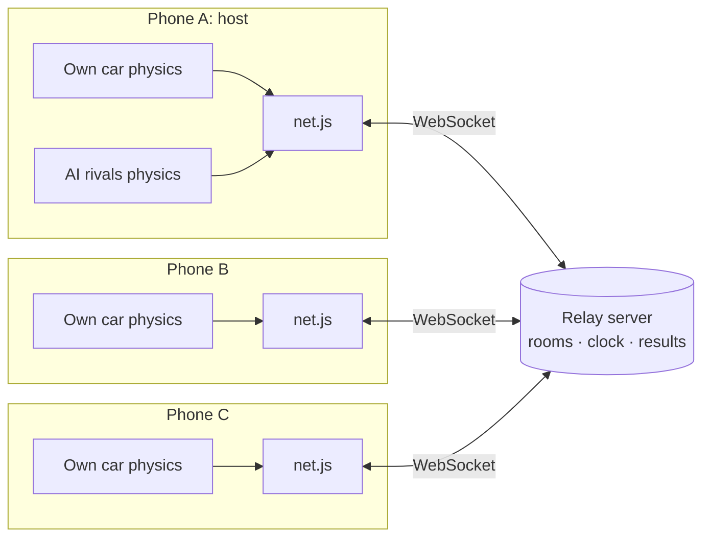
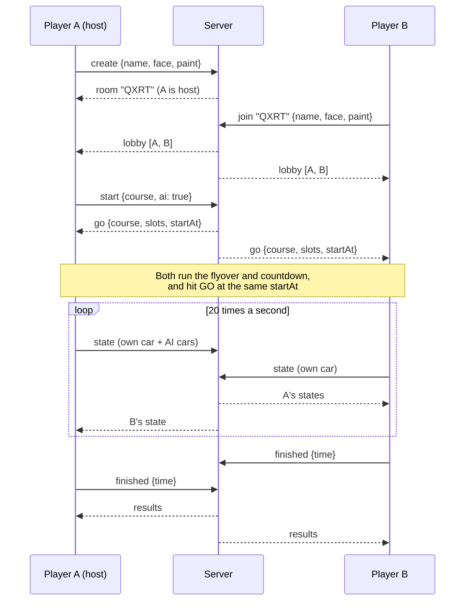

# Midship Drift III: multiplayer spec

A plan for racing 2, 3 or 4 people against each other over the internet, each on their
own phone or computer. It starts with how the game works today, because the multiplayer
design leans on it.

Status: **stages 1 and 2 are built** (see the build plan in section 4): rooms, the lobby,
the synced start, other players' cars, bumping and server results, for up to 4 players.
The code is in `js/net.js`, the online parts of `js/game.js` and `../server/server.js`,
hosted on Render via `../render.yaml`. Stages 3 and 4 (AI rivals online, reconnects, host
hand-over, online championships) are still to do. Where the built version differs from
this plan:

- Online races are humans only, with no AI rivals yet.
- The pause key opens a menu with **Leave race**, but the race keeps running.
- Leaving mid-race removes that player's car straight away, rather than pulling it over.
- Pinging uses a 2-second interval, and remote cars are drawn 120 ms in the past.

---

## 1. How the game works today

### Files

| File | What it does | Multiplayer impact |
| --- | --- | --- |
| `index.html` | Page, menus (title, courses, garage, results, pause), touch buttons | Add a lobby panel |
| `js/art.js` | Pixel-art scenery, backdrops and the tiny font | None |
| `js/toons.js` | Driver faces, winged START sign, smoke and sparks | None |
| `js/courses.js` | Themes, the 5 course outlines, the 10 `DRIVERS`, paints | None |
| `js/track.js` | Builds a course: resamples it, finds crossings, lifts bridges | None (same input gives the same track on every device) |
| `js/gl.js` | WebGL renderer: fogged meshes and upright sprites | None |
| `js/models.js` | Cartoon car models | None |
| `js/scene.js` | Builds the road, rails, pillars, ground and scenery mesh | None |
| `js/audio.js` | Engine, skid, bumps, music | Minor (engine note only for your own car) |
| `js/game.js` | Everything else: physics, AI, camera, HUD, menus, race flow | **Most changes are here** |
| `js/net.js` | Does not exist yet | **New**: connection, messages, clock sync |

Everything is static files with no build step, which is why GitHub Pages can host it.
Multiplayer adds one thing that can't be static: a small real-time server.

### The frame loop

`game.js` runs physics at a fixed **120 steps per second** (`STEP = 1/120`) and draws
once per screen refresh:

```
requestAnimationFrame → frame()
   ├─ update(STEP) × as many as needed to catch up
   │    ├─ race flow: intro → countdown → race → finish
   │    ├─ each car: drivePlayer() or driveAI(), then integrate() and pose()
   │    ├─ collide()              car-to-car bumps
   │    ├─ laps, positions, finishing, sounds
   │    └─ particles (smoke, sparks)
   └─ render()  sky → track mesh → scenery → cars → sprites → HUD
```

### How a car is described

Cars live in **track coordinates**, not x/y/z. This is the most important thing for
multiplayer, because it makes a car's state small and easy to send.

| Field | Meaning |
| --- | --- |
| `s` | Distance driven along the road in metres. Keeps counting past each lap, so `s / L` is laps done. Starts negative on the grid. |
| `d` | Sideways offset from the centre line, metres (right is positive, road edge at about ±7) |
| `h` | Where the nose points, relative to the road (radians) |
| `phi` | Direction of travel relative to the road. `h ≠ phi` means sliding. |
| `v` | Speed, m/s |
| `y`, `vy`, `air` | Height, climb rate, whether the car is airborne |
| `drift`, `driftT`, `boost` | Drift direction (−1, 0, 1), how long it has been held, turbo time left |
| `steer` | Smoothed steering, −1 to 1 (also tilts the nose in the drawing) |

Everything else on a car (`pos`, `lapTimes`, `best`, `mood`, smoke timers, the `pose`
used for drawing) is either derived from those or purely cosmetic.

`pose(c)` turns `s, d, h, phi, y` into a world position and orientation for drawing. It
needs only the track, so any device can draw any car from those few numbers.

### The race object

`newRace()` builds one `race` object that holds the course, track, the 10 cars, timers
(`introT`, `countT`, `goT`, `clock`), messages and particles. `race.player` is Leo's car;
the HUD, camera, sounds and AI catch-up all key off it. There's a single global `mode`:
`title`, `intro`, `countdown`, `race`, `finish` or `garage`.

### Things that matter for multiplayer

- **The track is deterministic.** `Track.build(course)` gives identical results on every
  device, so only the course number needs sending.
- **The AI uses `Math.random()`** for lane changes, so two devices running the same AI
  would disagree. Only one device should run the AI.
- **The AI's catch-up** (`c.rubber`) looks at `race.player`. With several humans it needs a
  new rule.
- **Pausing** stops the whole simulation. That can't work online.
- **Phones throttle background tabs.** If someone switches app, their game stops running.

---

## 2. Design

### Who decides what

The design is "each player owns their own car": nobody waits for a server to say where
their car is, so steering always feels instant, even on slow mobile data.

| Thing | Decided by |
| --- | --- |
| Your car's movement | **Your device**. You simulate it exactly as today and broadcast its state. |
| Other players' cars | Their devices. You only display them, smoothly interpolated. |
| AI rivals | **The host**: whoever created the room. The host simulates them and broadcasts their states. |
| Room, who is in it, start time, finishing order | **The server** |
| Bumps between cars | Each device bumps **only its own car** away from others |



The server is a **relay**: it passes each player's updates to everyone else in the room,
and owns only the room list, the start time and the results. It does no physics, so it
stays tiny and cheap.

### Server options

| Option | Good | Less good |
| --- | --- | --- |
| **Small Node.js server with WebSockets** (the `ws` package) on Fly.io, Render or Railway | Easy to understand, runs locally for testing, free or cheap tiers | One more thing to deploy; free tiers may sleep and take a few seconds to wake |
| Managed real-time service (PartyKit, Cloudflare Durable Objects) | No server to look after, scales on its own | Learning a platform's own API |
| Peer-to-peer (WebRTC) | No relay traffic | Still needs a server to introduce the peers; some mobile networks block direct connections |

**Recommendation:** start with the small Node server. It's about 150 lines, you can run
it on your PC while testing with two browser tabs, and move it to a host later. The game
stays on GitHub Pages and connects to the server's `wss://` address.

### Room flow



- **Rooms** use a 4-letter code you read out to friends. No accounts.
- **Lobby:** each player picks a driver face from the 10 `DRIVERS` (no two the same) and,
  for the MR2, a paint. The host picks the course and whether AI rivals fill the grid.
- **Grid:** humans take the first grid slots in join order; AI cars fill the rest up to
  10, or the race is humans only.
- **Starting together:** the server sends `startAt`, a time about 6 seconds ahead on its
  own clock. Each device converts that to its own clock (see clock sync below) and times
  the 4-second flyover and 3-second countdown so GO happens at `startAt`. The winged START
  sign flaps away on every screen at the same moment.

### Messages

JSON over WebSocket. Short keys keep messages small; numbers are rounded to 2 decimal
places.

| Message | Direction | Contents |
| --- | --- | --- |
| `create`, `join` | client → server | `name`, `face` (driver index), `paint`; `join` adds the `room` code |
| `lobby` | server → all | Players in the room, who's host, what each picked |
| `start` | host → server | `course`, `ai` on/off, `laps` |
| `go` | server → all | `course`, `laps`, grid `slots` (who's in which), `startAt` |
| `ping` / `pong` | both | Timestamps for clock sync and showing each player's lag |
| `st` | client → server → others | One car's state (below), 20 per second |
| `ai` | host → server → others | Every AI car's state, 10 per second |
| `fin` | client → server | Your finish time and best lap |
| `results` | server → all | Final order once everyone finishes, or 30 s after the first does |
| `left` | server → all | A player disconnected |

A car state message:

```json
{ "t": "st", "id": 2, "k": 41.37, "s": 1532.6, "d": -3.1, "h": 0.42, "phi": 0.18,
  "v": 61.2, "y": 4.7, "vy": -2.1, "dr": 1, "b": 0, "st": 0.8 }
```

`k` is the sender's clock time when the state was taken. About 120 bytes, 20 times a
second, 4 players: roughly 10 KB/s per phone, which is nothing even on mobile data.

### Clock sync

Every 2 seconds each client sends `ping` with its local time. The server replies with its
own time, and the client estimates the offset:

```
offset ≈ serverTime − (sendTime + receiveTime) / 2
```

Keep a rolling average of the offset from the lowest-latency pings. Race time is then
`serverTime − startAt` on every device, so lap timers and the finish line agree.

### Showing other cars smoothly

Remote cars are drawn **slightly in the past**, about 100 ms back, by interpolating
between the two states either side of that moment. Track coordinates make this easy:
`s` keeps counting past each lap, so there's no wrap-around to worry about, and
interpolating `s` and `d` keeps a car on the road even round tight bends.

If updates stop arriving (a bad signal), extrapolate for up to 0.3 s using `v` and
`phi`, then freeze the car where it is and fade it to a "ghost" until data returns.

### Collisions

`collide()` today pushes both cars in every touching pair apart. Online, each device
handles only pairs that include **its own car**, and moves only its own car. The other
player's device does the same from its side, so both get bumped. The two may not agree to
the centimetre, but the result looks right and nobody gets teleported.

AI cars are moved only by the host. The host bumps them against everything it can see.

### Positions, laps and finishing

- **Running order** for the faces bar comes from everyone's latest `s`, exactly as
  today. Every device works it out from the states it has.
- **Laps** are counted locally from your own `s`, as now.
- **Finishing:** when your car crosses the line on the last lap, you send `fin` with your
  race time. The server's results order uses those times, so a laggy connection can't
  cost you a place. The existing results table and championship points work unchanged
  once they're fed the server's order.

### AI catch-up with several humans

Today each AI car eases off when it's ahead of Leo. Online, use the **last-placed human**
instead, so the pack stays catchable for the slowest player. This is a one-line change in
`driveAI()`. Make it a host option ("help the last player: on/off").

### Things that change in the game's behaviour

| Today | Online |
| --- | --- |
| P pauses the race | No pause. P opens a "Leave race?" menu while your car coasts. |
| Switching apps pauses (`blur`) | Your car keeps its last state; others see it as a ghost after 1 s. Coming back resyncs your clock and carries on. |
| `race.player` is Leo | `race.local` is whichever car this device drives. Its driver can be any of the 10 faces. |
| Championship over 5 courses | Single races to start with. A championship needs the server to keep points between races (stage 4). |
| AI on every device | AI only on the host; everyone else draws it from `ai` messages |

### Disconnects

- **A player leaves:** their car pulls off to the side of the road and fades out, and
  their face greys out in the bar. The race carries on.
- **The host leaves:** the AI cars freeze, or the server picks a new host, who takes over
  simulating the AI from the last known states (stage 4).
- **Reconnecting:** rejoin with the same room code within 30 s. The server remembers your
  slot and you continue from your last reported `s`.

---

## 3. Code changes

### `game.js`

1. **Car kinds.** Replace `human: true/false` with `kind: 'local' | 'remote' | 'ai'`.
   In `update()`:
   - `local` → `drivePlayer()`, as today
   - `ai` → `driveAI()`, only on the host
   - `remote` and AI on non-hosts → `net.sample(car, renderTime)`, which writes the
     interpolated state onto the car, then `pose()`

2. **`race.player` becomes `race.local`.** Camera, HUD, engine sound, wrong-way and
   finishing all follow your own car. The faces bar highlights your face, and can outline
   the other humans in their colours.

3. **`newRace(idx, opts)`** takes the grid from the server's `go` message (who sits in
   which slot) instead of always putting Leo seventh. Driver faces and paints come from
   the lobby picks.

4. **Race clock.** In online races `R.clock` and the countdown come from the synced
   server time rather than adding up `dt`, so everyone's GO and lap timers line up.

5. **`collide()`** only touches pairs that include the local car (or, on the host, AI
   cars).

6. **Sending.** Every 50 ms send `st` for the local car. On the host, every 100 ms send
   `ai`.

7. **Menus.** Add an "Online race" button on the title screen, and a lobby panel with the
   room code, player list, face picker, course picker (host only) and Start (host only).

### `net.js` (new, about 200 lines)

- `connect(url)`, `create()`, `join(code)`, `start(opts)`
- Clock sync with `ping` and `pong`
- A small buffer per remote car of the last ~1 s of states
- `sample(car, time)`: interpolates or extrapolates a remote car
- Callbacks for the game: `onLobby`, `onGo`, `onResults`, `onLeft`

### `server/` (new, about 150 lines)

A Node.js program using the `ws` package:

- Keeps rooms in memory: code, players, host, state (`lobby` or `racing`), start time,
  finish times
- Relays `st` and `ai` messages to the other players in the room, untouched
- Answers `ping`, sends `go` with `startAt`, collects `fin`, sends `results`
- Basic limits: at most 4 players a room, at most ~30 messages per second per player,
  rooms deleted after 10 minutes without anyone in them

It lives in its own folder with its own `package.json`, so the game still has no build step.

---

## 4. Build plan

Each stage can be played before starting the next.

| Stage | What you get | Rough size |
| --- | --- | --- |
| **1. Two ghosts** | Server, room codes, 2 players see each other's cars in real time. No AI, no collisions, no results. | Server + `net.js` + small `game.js` changes |
| **2. A proper race** | Synced countdown and START sign, collisions, finish order, results table, up to 4 players | Clock sync, `collide()` change, `fin`/`results` |
| **3. With the pack** | Host runs the AI rivals; faces bar shows humans and AI; catch-up keyed to the last-placed human | `ai` message, host logic |
| **4. Polish** | Lobby face and paint pickers, reconnects, host hand-over, online championship, lag indicator on each face | Mostly UI and server bookkeeping |

### Testing

- **On one PC:** run the server locally and open the game in two or more browser
  windows. Each window is a player.
- **Lag:** the browser's developer tools can throttle a tab's network to "Slow 4G" to see
  how interpolation copes.
- **Real phones:** host the server publicly, open the GitHub Pages site on two phones on
  mobile data (not the same Wi-Fi), and race.
- **Automated:** the existing `__md3` test hook can drive cars, so a script can run two
  headless players and check they agree on finishing order.

---

## 5. Open questions

- **Server host:** Fly.io, Render, or a managed service? Free tiers that sleep add a
  few seconds' wait when the first player joins.
- **Who can join:** anyone with the code (simplest), or a fixed list of friends?
- **Should humans see each other's names** above their cars, or just the faces in the bar?
- **Phones in one room:** play over the internet only, or also allow a "same Wi-Fi"
  mode later?
- **Split screen** on one device (2 players, one keyboard) is a different, simpler
  feature that needs no server. It may be worth doing first if the main use is two
  people sitting together.
